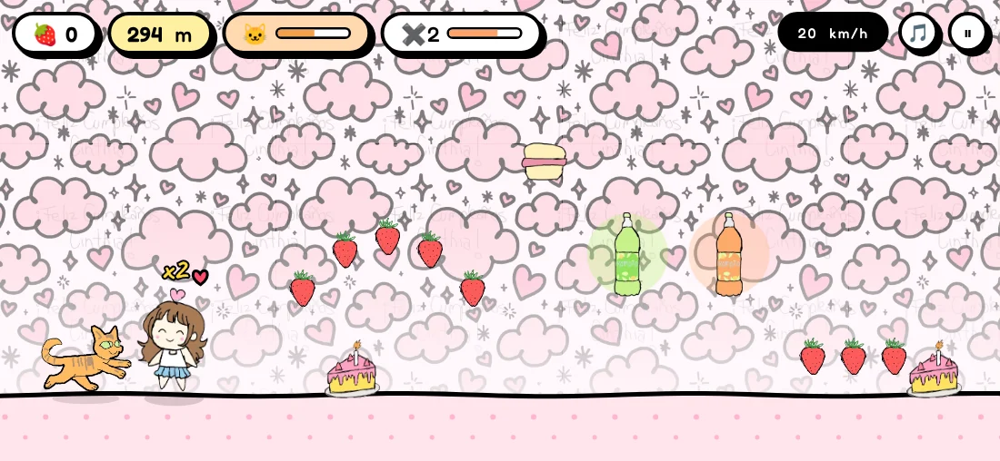
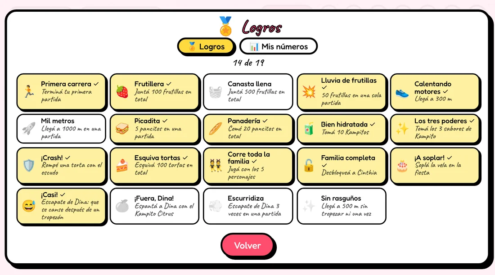
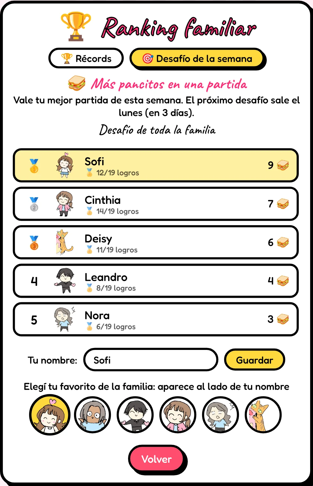
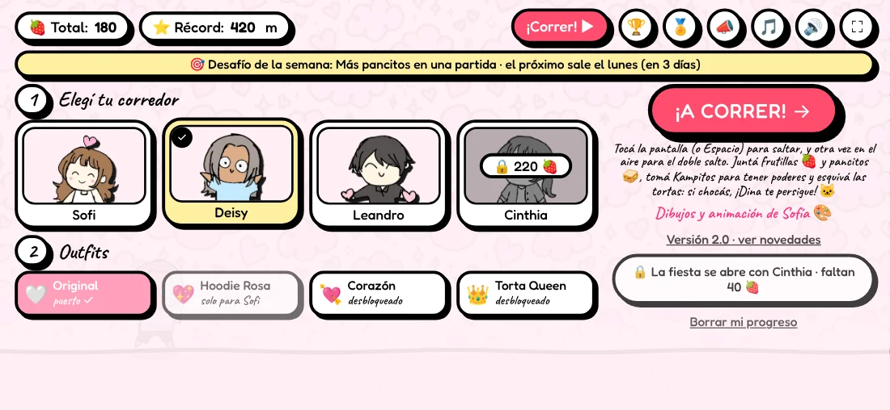
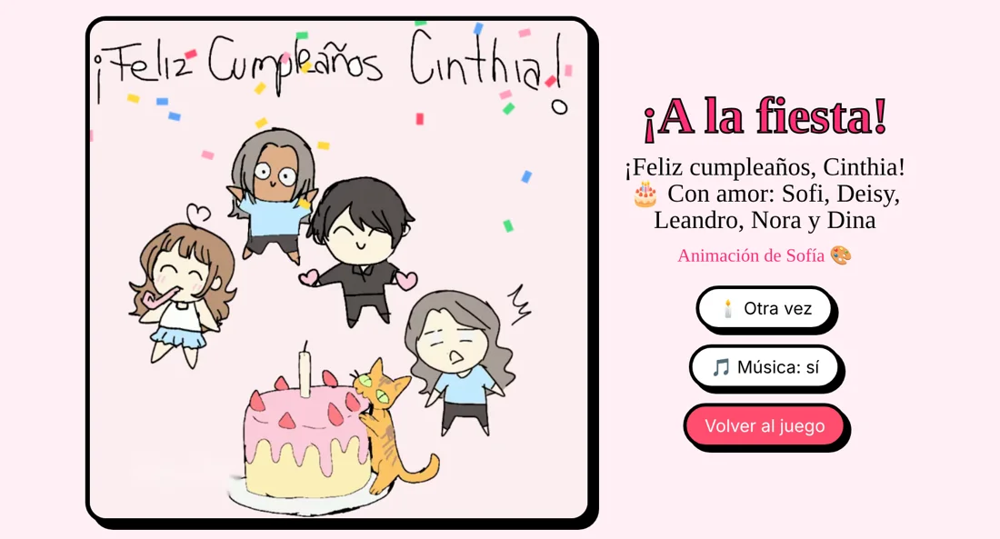
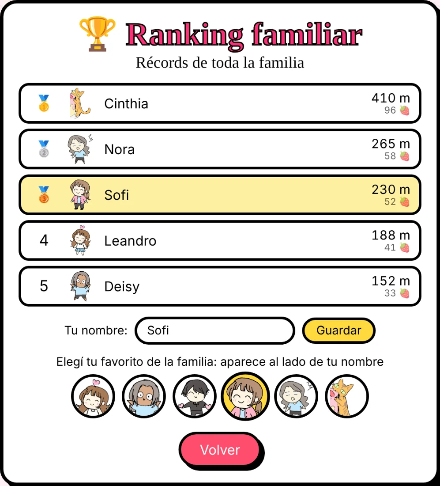
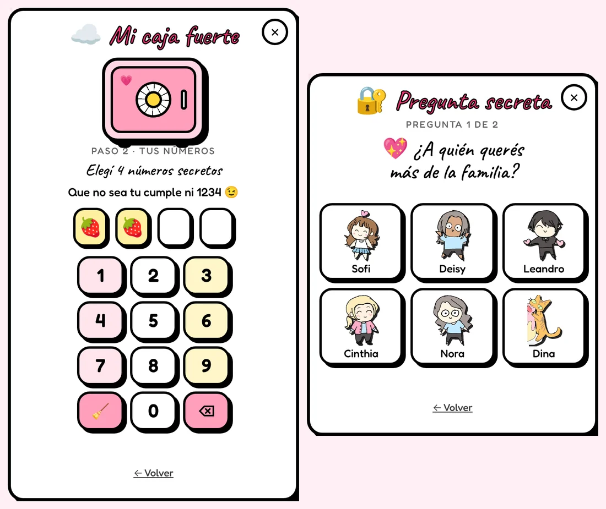

# Torta Runner 🍓🎂

Un *infinite runner* de cumpleaños hecho en familia para Cinthia, con dibujos y animación de Sofía.

Corrés con Sofi, Deisy, Leandro o Cinthia, juntás frutillas y esquivás porciones de torta. Si chocás… Dina se come la torta.

**▶ Jugar:** https://LeandroACasco.github.io/torta-runner/

## Cómo se juega

La primera vez hay una carrera de práctica corta: un dedito te muestra cuándo saltar y cuándo hacer el doble salto, y después vienen el pancito y un Kampito. Se puede repetir desde el menú, con *Repetir la carrera de práctica*.

- **Saltar:** tocá la pantalla o hacé clic. En la computadora también sirven Espacio, ↑ o W.
- **Doble salto:** saltá de nuevo en el aire.
- **Pausa:** botón ⏸, o P / Esc. Al volver hay una cuenta 3-2-1.
- **Música:** botón 🎵, o la tecla M.
- **Ajustes ⚙️:** sonido, volumen de la música y de los efectos, vibración, cuenta 3-2-1 y menos confeti.

Juntá frutillas 🍓 y esquivá las porciones de torta. La velocidad sube de a poco. Las frutillas que juntás se suman a tu total y sirven para desbloquear a la familia.

## Las comiditas de la fiesta

Lo que se comió de verdad en el cumple de Cinthia, dibujado por Sofía:

- **Pancito con salame 🥪:** vale 5 frutillas. Aparece en lo alto, en la punta de los arcos de frutillas.
- **Kampito 🧃:** el jugo de la fiesta, en sus 3 sabores. Es más raro y cada sabor te da su poder por unos segundos:
  - 🟢 **Green** (melón, kiwi y limón) → 🧲 **Imán:** las frutillas y los pancitos cercanos vuelan hacia vos.
  - 🟡 **Tropical** (maracuyá, naranja y mango) → ✖️2 **Frutillas dobles:** todo vale el doble.
  - 🟠 **Citrus** (naranja, mandarina y limón) → 🛡️ **Escudo:** la próxima torta que te toque se rompe en migas en vez de pararte.

## Logros 🏅

Hay 19 logros para ganar, desde *Primera carrera* hasta *¡A soplar!* (soplar la vela en la fiesta), y 4 de ellos son para escaparse de Dina. Se ven con el botón 🏅 y la cantidad de cada uno aparece en el ranking. En la misma pantalla, la pestaña 📊 *Mis números* muestra tus estadísticas.

## Desafío de la semana 🎯

Todos los lunes sale un desafío nuevo (más pancitos en una partida, llegar lo más lejos, más tortas esquivadas…). Vale tu mejor partida de esa semana y se ve en la pestaña *Desafío de la semana* del ranking. Quien gana la semana lleva una corona 👑 en el ranking la semana siguiente, y al lado de cada nombre se cuentan los desafíos ganados 🏆.

## La familia

| Personaje | Frutillas para desbloquear |
| --- | --- |
| Sofi | Desde el inicio |
| Deisy | 50 |
| Leandro | 120 |
| Cinthia, la cumpleañera | 220 (deja un rastro de confeti) |

También hay outfits para ponerle a tu personaje: Hoodie Rosa, Corazón flotante y Corona Torta Queen.

## La fiesta

Cuando desbloqueás a Cinthia se abre la fiesta: contás hasta uno, soplás la vela y empieza el festejo con toda la familia, confeti y el Feliz Cumpleaños.

## Ranking familiar 🏆

Al terminar una partida anotás tu nombre y tu récord queda en el ranking de la familia, junto con cuántos logros ganaste. Cada uno elige a su favorito de la familia (Sofi, Deisy, Leandro, Cinthia, Nora o Dina) para que aparezca al lado de su nombre.

Los nombres del ranking los ve cualquiera que juegue.

## Caja fuerte ☁️

Tu progreso se puede guardar en una caja fuerte para seguir jugando en otro celular o en la compu sin empezar de cero. Tocá ☁️ en el menú, elegí tu nombre y 4 números secretos, y respondé de 1 a 3 preguntas secretas eligiendo a alguien de la familia (por ejemplo, *¿A quién querés más de la familia?*). Si un día te olvidás los números, abrís la caja fuerte con esas respuestas y elegís números nuevos.

En otro dispositivo: ☁️ → *Ya tengo una* → tu nombre y tus números. Se guarda sola cada vez que terminás una partida, y si jugaste en dos dispositivos se suma lo de los dos.

## Jugar en el celular como app

El juego se puede instalar y jugar sin internet una vez abierto.

- **Android (Chrome):** menú ⋮ → *Agregar a la pantalla principal*.
- **iPhone (Safari):** botón Compartir → *Agregar a inicio*.

Tu progreso se guarda en el dispositivo donde jugás (y en tu caja fuerte, si la creaste). Cuando sale una versión nueva, el menú te avisa: tocá el cartel y se actualiza.

## Cumpleaños de la familia 🎂

El día del cumple de alguien de la familia, el juego lo saluda con confeti y todos pueden correr con el cumpleañero, que lleva corona. El día del cumple de Cinthia, la fiesta se abre para todos.

## Novedades

Cada vez que sale una versión nueva, el juego muestra sus novedades al abrirlo. También se pueden ver con el botón 📣 del menú. La lista completa está en [CHANGELOG.md](CHANGELOG.md).

## Créditos

| Qué | Quién |
| --- | --- |
| Dibujos, personajes y animación (también el pancito y los Kampitos) | **Sofía** 🎨 |
| Dina corriendo | Hecha con IA a partir del dibujo de Sofía |
| Idea y producción | Leandro |
| Programación | Leandro, con asistencia de IA (Meta AI en los prototipos, Claude en la versión actual) |
| Música | Partida: melodía original. Fiesta: *Happy Birthday to You* (dominio público) |
| Tipografías | [Caveat](https://fonts.google.com/specimen/Caveat) y [Fredoka](https://fonts.google.com/specimen/Fredoka) (Google Fonts, licencia OFL) |

## Licencia

- **Código:** MIT (ver [LICENSE](LICENSE)).
- **Dibujos y animación** (todo lo que está en `assets/` y `docs/`): © Sofía. Todos los derechos reservados. No se pueden copiar ni reutilizar sin su permiso.
